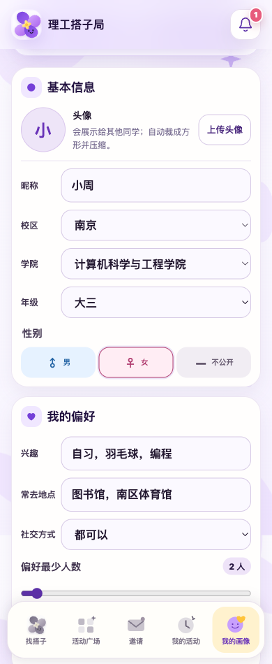

[简体中文](README.md) | **English**

# Ligong Dazi

For a game, a study session or a campus activity, turn “we need one more person” into a plan that actually comes together.

[Open Ligong Dazi](https://ligong-dazi.zeabur.app/)

  
  

*Interface examples use existing repository previews; some navigation labels vary by version.*

## Find more than a shared activity

Enter an activity, time and what you have in mind. Discover existing activities on your campus or look for suitable partners. Matching considers interests, location, time, skill and social preferences, explains its recommendations and accepts requests such as finding an experienced partner to help a beginner.

## Get to know each other first

Profiles describe interests, skills, familiar places and social preferences. Activities and reviewed feedback add context about reliability. Look through candidates before deciding whom to join.

## Follow through on the plan

Confirm before publishing, inviting or applying, then keep the arrangement under My Activities. Receive reminders, share meetup photos and vote on rescheduling. Leave feedback afterward; situations needing verification enter a review process.

## Try it

Register on the website, choose the Nanjing or Jiangyin campus and complete your basic profile to browse activities. Default rule-based matching does not require a paid model API.

[Website](https://ligong-dazi.zeabur.app/) · [Android app](https://ligong-dazi.zeabur.app/downloads/ligong-dazi-native.apk) · [Releases](https://github.com/DrivingGodJ/ligong-dazi/releases)

## Explore further

| Topic | Documentation |
| --- | --- |
| Usage, local startup and data permissions | [User guide](docs/GUIDE.en.md) |
| Reliability, notifications, accounts and Android upgrades | [Full feature reference (Chinese)](docs/readme-reference.zh-CN.md) |
| Host your own service | [Zeabur](DEPLOY_ZEABUR.md) · [Railway](DEPLOY_RAILWAY.md) |
| Updates and collaboration | [Changelog](CHANGELOG.md) · [Contributing](CONTRIBUTING.md) · [Issues](https://github.com/DrivingGodJ/ligong-dazi/issues) |

See the [guide](docs/GUIDE.en.md#license-and-credits) for licensing and usage terms.
