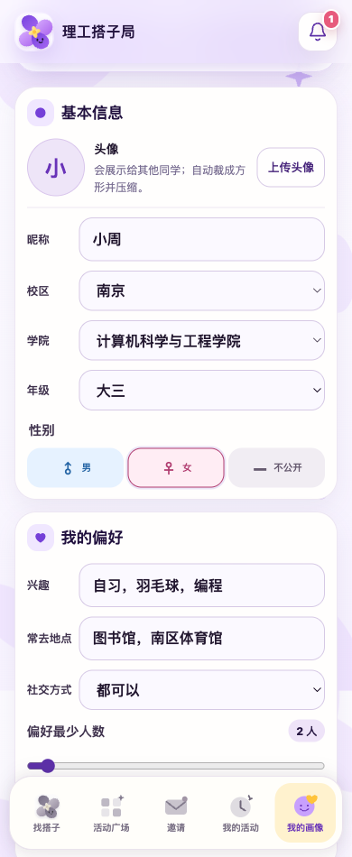
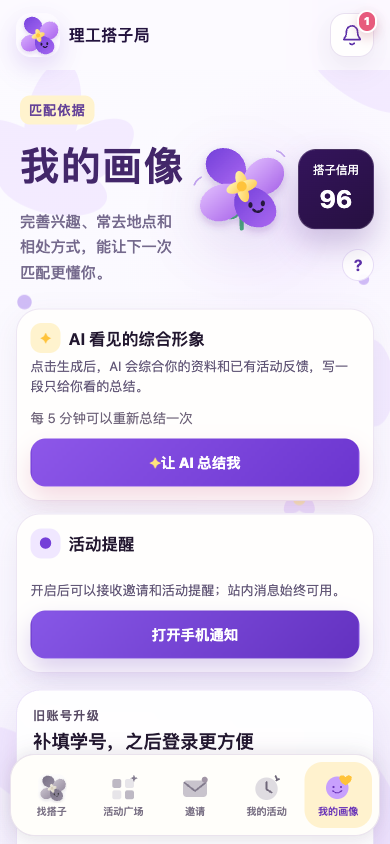

**简体中文** | [English](README.en.md)

# 理工搭子局

想打球、去自习，或找人一起参加活动时，从“还差一个人”走到真正约成一局。

[打开理工搭子局](https://ligong-dazi.zeabur.app/)

  
  

*界面示例来自仓库内的既有预览，部分导航名称随版本调整。*

## 不只找同样想做这件事的人

输入活动类型、时间和自己的想法，查看同校区已有活动，也可以寻找合适的伙伴。匹配会综合兴趣、地点、时间、水平与社交偏好，并展示推荐理由；“希望有熟练的人带新手”这样的需求也能一并表达。

## 从了解彼此开始

个人主页记录兴趣、水平、常去地点与社交方式，活动和经审核的评价帮助补充履约表现。你可以先了解候选，再决定与谁同行。

## 让活动有后续

确认后再发布、邀请或申请加入，把安排留在“我的活动”。临近开始可接收提醒、共享集合照片，也能通过投票商量改期。结束后留下评价；需要核实的情况进入复核，不让一次活动只剩下一条聊天记录。

## 开始体验

在网站注册并选择南京或江阴校区，填写基础资料后即可浏览活动。默认规则匹配无需购买模型 API。

[网页版](https://ligong-dazi.zeabur.app/) · [安卓应用](https://ligong-dazi.zeabur.app/downloads/ligong-dazi-native.apk) · [发行记录](https://github.com/DrivingGodJ/ligong-dazi/releases)

## 进一步了解

| 想了解什么 | 去哪里看 |
| --- | --- |
| 使用流程、本地启动与数据权限 | [使用指南](docs/GUIDE.zh-CN.md) |
| 信用、通知、账号与安卓升级 | [完整功能参考](docs/readme-reference.zh-CN.md) |
| 部署自己的服务 | [Zeabur](DEPLOY_ZEABUR.md) · [Railway](DEPLOY_RAILWAY.md) |
| 更新与协作 | [更新记录](CHANGELOG.md) · [贡献指南](CONTRIBUTING.md) · [Issues](https://github.com/DrivingGodJ/ligong-dazi/issues) |

许可与使用条件见[指南](docs/GUIDE.zh-CN.md#许可与致谢)。
